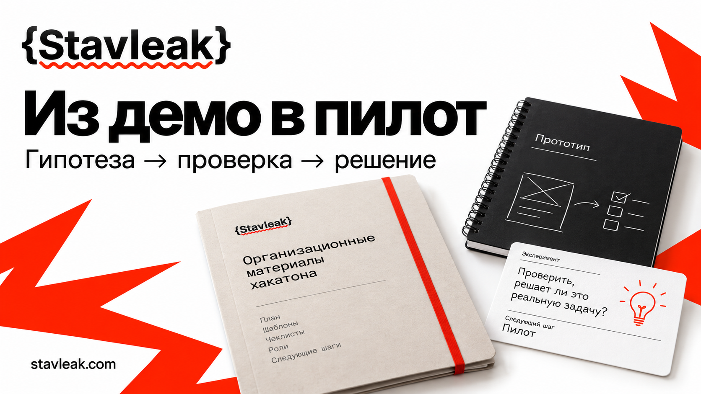

<p><a href="https://stavleak.com/ru"><picture><source media="(prefers-color-scheme: dark)" srcset="assets/stavleak-logo-dark.svg"></picture></a></p>

<a href="https://stavleak.com/ru"></a>

# Передача прототипа и проверка после хакатона



После финала остаются код и презентация, но часто нет согласившегося владельца, воспроизводимого сценария и даты решения. Этот набор помогает передать прототип, проверить одну гипотезу и записать обоснованное продолжение или остановку.

**Цель репозитория:** у каждого выбранного проекта есть добровольно согласованные владельцы, проверяемая версия, ограниченный эксперимент и решение по наблюдениям. Если условий для проверки нет, полезный результат состоит в честной записи причины и архивировании.

Материалы подготовлены [Stavleak](https://stavleak.com/ru). Stavleak организует события для организаций и открывает ту же рабочую среду организаторам, которые собирают событие самостоятельно или совместно с командой. Здесь доступны самостоятельные организационные шаблоны; заполнение файлов не запускает рабочие процессы на сайте.

<!-- stavleak:application -->
## Рабочее приложение

В репозитории есть интерфейс на **Next.js** и сервер на **Rust**. Создавайте реальные записи через формы: сервер проверяет их и сохраняет в локальный файл. Начальное состояние пустое; учебные данные загружаются отдельной кнопкой с подтверждением.

Нужны Node.js 22+, pnpm 10.33.0 и установленный Rust 1.88+ с системным линкером. В Windows стандартному Rust MSVC нужны Visual Studio Build Tools с компонентом Desktop development with C++; в Linux — C/C++ toolchain.

```sh
pnpm install --frozen-lockfile
pnpm setup
pnpm dev
```

`pnpm setup` предложит задать пароль и создаст случайные серверные ключи в игнорируемом `.env.local`. Откройте **http://127.0.0.1:3005/ru** и войдите с выбранным паролем. Одновременно работает одно приложение на стандартных портах 3005 и 3006.

Данные сохраняются в `data/state.json`. Обновление устаревшей версии возвращает конфликт, а закрытые предметные записи защищены серверными правилами. Пароль, ключи и рабочие данные не входят в публичный репозиторий. [Возможности и сценарии](docs/application.md) · [Запуск, резервные копии и границы доступа](docs/local-operation.md).

Проверка: `pnpm check`; сборка интерфейса: `pnpm build`; рабочий запуск сборки: `pnpm start`. Приложение рассчитано на одну закрытую локальную рабочую среду организатора. Русский интерфейс находится по `/ru`; переводы на другие языки пока не созданы.

Шаблоны и примеры ниже дополняют приложение. CSV-файлы не импортируются и не синхронизируются автоматически: используйте их отдельно либо переносите нужные записи через формы.

## Начните за 15 минут

1. **0–3 минуты.** Выберите один проект и один наблюдаемый шаг пользователя. Скопируйте [передачу прототипа](templates/handover.md) в закрытый рабочий каталог. Назначьте владельца процесса и технического владельца только после их согласия. Если никто не согласился, запишите `blocked` и дату архивирования.
2. **3–7 минут.** Укажите версию, безопасный вход, ожидаемый выход, сброс и известные ограничения. Добавьте документы в [реестр артефактов](templates/artifact-register.csv). Человек, который не писал прототип, должен повторить сценарий до допуска к проверке.
3. **7–12 минут.** Заполните [карточку эксперимента](templates/experiment.md): исходное состояние, все начатые попытки в знаменателе, плановый объём, порог, условия остановки и дату разбора. Не запускайте проверку, пока есть обязательное незаполненное поле.
4. **12–15 минут.** Пройдите [приёмку](templates/acceptance.md), назначьте время первого наблюдения и ответственного за [журнал](templates/observations.csv). После проверки внесите решение в [decision-log.csv](templates/decision-log.csv).

15 минут достаточно для первичного плана. Воспроизведение, разрешения, подготовка и сам эксперимент могут потребовать отдельного времени. Начинайте на синтетических данных, если согласованные рабочие данные ещё недоступны.

## Что внутри

| Файл | Какую проблему закрывает |
|---|---|
| [Передача прототипа](templates/handover.md) | Нет владельца, версии или понятного способа воспроизведения |
| [Карточка эксперимента](templates/experiment.md) | «Попробуем пилот» не превращается в проверяемый вопрос |
| [Приёмка](templates/acceptance.md) | Успешное демо ошибочно считают допуском к рабочему процессу |
| [Реестр артефактов](templates/artifact-register.csv) | Ссылки устарели, непонятны доступ и срок хранения |
| [Наблюдения](templates/observations.csv) | В результат попадают только удачные попытки |
| [Журнал решений](templates/decision-log.csv) | Продолжение не связано с наблюдениями и следующей датой |
| [Рабочий порядок](docs/workflow.md) | Зависимости и данные остаются без ответственного |

Посмотрите два вымышленных разбора: [продолжить маленькую проверку](examples/continue.md) и [остановить при нарушении правила](examples/stop.md). У них общие [наблюдения](examples/observations.csv), [реестр](examples/artifact-register.csv) и [решения](examples/decision-log.csv). Это учебные записи, не результаты Stavleak или клиентов.

## Когда задача закрыта

- Владелец процесса и технический владелец явно согласились на указанный объём и срок; кто-либо из них может остановить эксперимент.
- Независимый проверяющий повторил конкретную версию на разрешённом наборе и проверил возврат к прежнему порядку.
- Карточка содержит baseline, плановый объём, числитель, знаменатель, порог, ограничения и stop-rule, выбранные до запуска.
- Каждая начатая попытка попала в журнал; помощь, тайм-ауты, ошибки и остановки не исчезли из знаменателя.
- Решение ссылается на наблюдения, называет следующего добровольного владельца и срок либо подтверждает архивирование и закрытие доступов.

`continue` означает согласие на следующий ограниченный этап. Маленькая выборка не подтверждает пользу для всей организации, готовность к нагрузке или коммерческий эффект. `stop` и `archive` также закрывают задачу, если причина и возврат к прежнему процессу записаны.

## Границы использования

Участие в хакатоне, награда и сдача проекта не создают обязанность работать после события. Этот набор не передаёт права на проект, не устанавливает правила призов и не заменяет отдельные договорённости. Проверяйте права и условия использования конкретных артефактов до передачи; лицензия этого набора относится к самим материалам.

Храните заполненные рабочие журналы отдельно от открытого репозитория. Публичная копия должна содержать только шаблоны, синтетические примеры и специально согласованный итог без персональных данных, секретов и закрытых ссылок. Порядок полей и проверки CSV описан в [workflow](docs/workflow.md).

Для улучшений используйте [CONTRIBUTING.md](CONTRIBUTING.md). Условия использования материалов и фирменных знаков: [LICENSE](LICENSE), [NOTICE.md](NOTICE.md).

[Stavleak](https://stavleak.com/ru) · [Материалы организатора](https://org.stavleak.com/ru#toolkit)

<!-- stavleak:brand-footer -->
[Stavleak](https://stavleak.com/ru) · [Материалы организатора](https://org.stavleak.com/ru#toolkit)

<!-- stavleak:related-kits -->
## Другие задачи организатора

- [Очередь менторов](https://github.com/Stavleak/hackathon-mentor-dispatch-kit)
- [Смены волонтёров](https://github.com/Stavleak/hackathon-volunteer-shift-kit)
- [Ответы участникам](https://github.com/Stavleak/hackathon-participant-comms-kit)
- [Репетиция события](https://github.com/Stavleak/hackathon-event-rehearsal-kit)
